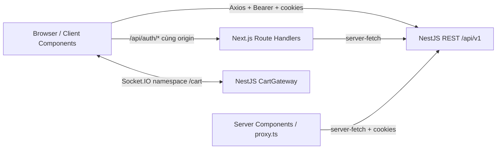

# Cosmetic Ecommerce — Client

Ứng dụng Next.js cho cửa hàng mỹ phẩm và giao diện quản trị, kết nối với [server NestJS](../server/README.md). Tài liệu dựa trên source code, scripts, lockfile và `.env.example`; không sử dụng giá trị từ `.env` hoặc `.env.prod`.

## Mục lục

- [Phạm vi và công nghệ](#phạm-vi-và-công-nghệ)
- [Kiến trúc và cấu trúc](#kiến-trúc-và-cấu-trúc)
- [Cài đặt và môi trường](#cài-đặt-và-môi-trường)
- [Chạy và kiểm tra](#chạy-và-kiểm-tra)
- [Docker](#docker)
- [Xử lý sự cố](#xử-lý-sự-cố)
- [Giới hạn và đề xuất](#giới-hạn-và-đề-xuất)

## Phạm vi và công nghệ

Các luồng có code triển khai:

- Trang chủ, collection theo slug, chi tiết sản phẩm, tìm kiếm và bộ lọc sản phẩm.
- Giỏ hàng, checkout, tạo đơn hàng, trang kết quả thanh toán VNPay.
- Đăng ký, đăng nhập, đăng xuất, quên/đặt lại mật khẩu, Google/Facebook OAuth và callback.
- Quản trị sản phẩm/biến thể, categories, collections, attributes, brands, country of origin và orders; có UI thư viện media dạng mẫu.

Sự tồn tại của page/service không chứng minh luồng đã được kiểm thử end-to-end. `/admin`, `/admin/users`, `/account`, `/account/orders` và `/admin/orders/new` hiện chỉ có nội dung placeholder. `/admin/media` dùng UI mẫu với dữ liệu tĩnh, chưa có service media riêng; không coi quản lý thư viện media là luồng hoàn chỉnh. Upload ảnh dùng feature `upload` riêng.

| Thành phần | Phiên bản khai báo / vai trò |
| --- | --- |
| Next.js / React / React DOM | `16.1.6` / `19.2.3` / `19.2.3`; App Router, Server và Client Components |
| TypeScript | `^5`, strict mode; alias `@/*` trỏ `src/*` |
| Tailwind CSS | `^4.2.1`, PostCSS; UI Radix/shadcn, Lucide, Sonner |
| TanStack Query / Table / Virtual | v5 / v8 / v3; cache API, bảng, danh sách lớn |
| Zustand / nuqs | v5 / v2; state auth/UI và query string |
| Axios / Socket.IO Client | v1 / v4; REST và đồng bộ giỏ hàng |
| React Hook Form / Zod | v7 / v4; form và validation |
| ESLint / Prettier | v9 / v3 |

`package.json` không khóa Node/npm bằng `engines` hoặc `packageManager`. Next.js đã cài khai báo Node `>=20.9.0`; Dockerfile dùng Node 24. Nên dùng **Node 24.x** để thống nhất với server. Có `package-lock.json`, các hướng dẫn dùng npm; chưa có phiên bản npm bắt buộc.

## Kiến trúc và cấu trúc



- `src/app` khai báo routes/layouts. Các route groups `(public)`, `(auth)`, `(protected)` không xuất hiện trong URL. Routes tiêu biểu: `/`, `/collections/[slug]`, `/products/[slug]`, `/cart`, `/checkout`, `/payment`, `/login`, `/register`, `/account`, `/admin/products`.
- `src/proxy.ts` dùng cookie để chuyển hướng các prefix `/admin`, `/account`, `/orders` và xử lý refresh. Proxy không kiểm tra role admin; quyền API phụ thuộc server.
- `src/lib/api-client.ts` gọi backend trực tiếp từ browser, thêm Bearer token từ Zustand, gửi cookies và `Idempotency-Key` cho request thay đổi dữ liệu. Khi access token hết hạn, gọi Route Handler refresh rồi thử lại request.
- `src/lib/internal-api-client.ts` có base URL tương đối `/api`. Route Handlers trong `src/app/api/auth` gọi NestJS qua `server-fetch`, lưu access/refresh token vào cookie `httpOnly`; login không trả refresh token trong JSON về browser.
- `src/lib/server-fetch.ts` dùng `BACKEND_API_URL` cho code phía Next.js server. Không tự thêm `/api/v1`.
- TanStack Query giữ cache dữ liệu server; Zustand giữ auth, dialog, lựa chọn giỏ hàng/category tree. `nuqs` đồng bộ bộ lọc/phân trang với URL. Providers lắp QueryProvider, NuqsAdapter và DialogManager.
- `use-cart-socket.ts` mở namespace `/cart` khi có JWT, cập nhật Query cache qua `cart:updated`, xử lý `cart:conflict`; guest không mở kết nối này.

| Đường dẫn | Trách nhiệm |
| --- | --- |
| `src/app/` | Pages, layouts, Route Handlers, error/not-found, global CSS |
| `src/features/` | Theo nghiệp vụ; thường gồm components, hooks, services, schemas, types; một số có store/lib |
| `src/components/ui/` | UI primitives; generator config tại `components.json` |
| `src/components/common/`, `layout/`, `pages/`, `data-table/` | Thành phần dùng chung, layout, nội dung trang và bảng |
| `src/components/dialog-manager/` | Registry và quản lý dialogs |
| `src/config/`, `constants/`, `enums/` | Validation môi trường, API endpoints và routes |
| `src/lib/`, `hooks/`, `providers/`, `stores/`, `types/` | Hạ tầng UI, API clients và state |
| `src/utilts/` | Utilities; tên thực tế là `utilts` |
| `public/` | Tài nguyên tĩnh |
| `next.config.ts`, `Dockerfile` | Standalone output, allowlist ảnh Cloudinary và container |

## Cài đặt và môi trường

Workspace khảo sát chứa **hai Git repository riêng**. Clone cạnh nhau để liên kết README tương đối hoạt động:

```bash
mkdir cosmetic-ecommerce
cd cosmetic-ecommerce
git clone git@github.com:phulocdev/cosmetic-ecommerce-fe.git client
git clone git@github.com:phulocdev/cosmetic-ecommerce-be.git server
cd client
npm ci
```

SSH URL lấy từ Git remote; cần quyền repository và SSH key. Nếu đã clone, chỉ cần vào `client` rồi `npm ci`.

Chuẩn bị Node 24.x, npm và backend theo [server README](../server/README.md#cài-đặt-và-chạy-local). Client không có database/migration/seed riêng; chạy đầy đủ nghiệp vụ cần các dịch vụ của server. Cài dependencies và tải font qua `next/font/google` cần kết nối mạng.

Trong PowerShell, tạo cấu hình nếu chưa có, không ghi đè file đang dùng:

```powershell
Copy-Item .env.example .env.local
```

Chỉnh `.env.local` theo ví dụ an toàn sau. **Mẫu hiện dùng backend `8080` và thiếu prefix**; nếu server chạy theo README ở `8000`, cần sửa cả hai URL backend:

```dotenv
NEXT_PUBLIC_BACKEND_API_URL=http://localhost:8000/api/v1
NEXT_PUBLIC_API_URL=http://localhost:3000
NEXT_PUBLIC_NODE_ENV=development
NEXT_PUBLIC_LOGOUT_SECRET_KEY=local-logout-marker
BACKEND_API_URL=http://localhost:8000/api/v1
API_URL=http://localhost:3000
NODE_ENV=development
LOGOUT_SECRET_KEY=local-logout-marker
```

| Biến | Bắt buộc | Mục đích |
| --- | --- | --- |
| `NEXT_PUBLIC_BACKEND_API_URL` | Có | Backend URL browser truy cập được, gồm `/api/v1`; cũng dùng suy ra Socket.IO URL |
| `BACKEND_API_URL` | Có | Backend URL từ Next.js server/container, gồm `/api/v1` |
| `NEXT_PUBLIC_API_URL`, `API_URL` | Có theo Zod | URL client hợp lệ; chưa thấy consumer khác ngoài validation |
| `NEXT_PUBLIC_LOGOUT_SECRET_KEY`, `LOGOUT_SECRET_KEY` | Có, không rỗng | Marker chuyển hướng logout; đặt cùng giá trị cho hai phía |
| `NEXT_PUBLIC_NODE_ENV` | Không, mặc định development | Zod kiểm tra development/production/test; chưa thấy consumer khác |
| `NODE_ENV` | Có theo Zod | development/production/test; ảnh hưởng cookie `secure` |

Mọi `NEXT_PUBLIC_*` đều công khai trong browser bundle. Logout marker không phải bí mật hay cơ chế phân quyền; không đặt credential vào đây. Next.js nhúng biến public lúc build, thay chúng cho production cần build lại.

## Chạy và kiểm tra

1. Khởi tạo database/dịch vụ và chạy server theo README server.
2. Kiểm tra `http://localhost:8000/api/v1` và Swagger `http://localhost:8000/docs`.
3. Trong `client`, chạy `npm run dev`, mở [http://localhost:3000](http://localhost:3000).
4. Kiểm tra trang chủ, danh sách/chi tiết sản phẩm khi đã có dữ liệu. DevTools → Network phải có request backend tới `http://localhost:8000/api/v1/...`, auth nội bộ tới `http://localhost:3000/api/auth/...`.
5. Đăng ký/đăng nhập để kiểm tra auth/cookie; dùng hai tab đã đăng nhập kiểm tra giỏ hàng. Email/OAuth/VNPay cần cấu hình thật hoặc sandbox riêng.

| Lệnh trong `client` | Tác dụng |
| --- | --- |
| `npm ci` | Cài theo lockfile |
| `npm run dev` | `next dev`, mặc định cổng 3000 |
| `npm run build` | `next build` |
| `npm start` | `next start`, chạy sau build |
| `npm run lint` | ESLint, script không có `--fix` |
| `npm run dev -- --port 3001` | Đổi cổng; cần cập nhật URL client/CORS/callback tương ứng |

Không có script test hoặc typecheck. Có thể kiểm tra TypeScript không ghi output bằng `npx --no-install tsc --noEmit --incremental false`.

## Docker

Dockerfile dùng Node 24 Alpine, dependencies/build/runner stages, Next.js standalone, user `nextjs`, expose 3000. Ví dụ PowerShell sau khi chuẩn bị `.env.prod` riêng bằng các tên biến phía trên:

```powershell
docker build -t cosmetic-client `
  --build-arg NEXT_PUBLIC_BACKEND_API_URL=http://localhost:8000/api/v1 `
  --build-arg NEXT_PUBLIC_API_URL=http://localhost:3000 `
  --build-arg NEXT_PUBLIC_NODE_ENV=production `
  --build-arg NEXT_PUBLIC_LOGOUT_SECRET_KEY=local-logout-marker `
  --build-arg BACKEND_API_URL=http://host.docker.internal:8000/api/v1 `
  --build-arg API_URL=http://localhost:3000 .
docker run --rm --name cosmetic-client --env-file .env.prod -p 3000:3000 cosmetic-client
```

Browser URL phải truy cập được từ browser; `BACKEND_API_URL` phải truy cập được từ container. Docker Desktop dùng `host.docker.internal` cho backend trên host; Linux cần host gateway/network phù hợp. Dockerfile đặt production và build bằng logout placeholder riêng; runtime cần `LOGOUT_SECRET_KEY` khớp public marker. Kiểm tra auth/cookie với HTTPS của môi trường triển khai. Các lệnh Docker chưa được chạy xác minh.

## Xử lý sự cố

| Hiện tượng | Kiểm tra và xử lý |
| --- | --- |
| `Invalid environment variables` | Đối chiếu `src/config/env.*.ts`, URL hợp lệ, logout marker không rỗng; restart dev sau đổi env |
| API 404 / connection refused | Kiểm tra 8000 so với 8080, có `/api/v1`, không lặp prefix, backend đã chạy |
| CORS / guest cart không giữ được | Backend dùng credentials; đặt origin đúng `http://localhost:3000`, không trộn hostname localhost và 127.0.0.1 |
| Logout redirect không hợp lệ | Hai logout marker phải khớp |
| Build font lỗi | Layout dùng Quicksand, Geist, Geist Mono qua `next/font/google`; kiểm tra mạng/proxy |
| Ảnh domain khác không hiện | `next.config.ts` chỉ allow remote image HTTPS từ `res.cloudinary.com`; domain khác cần maintainer cấu hình |
| Container không gọi được backend host | localhost trong container là chính container; kiểm tra URL server-side và host gateway |
| PowerShell chặn `npm.ps1` | Dùng `npm.cmd ci`, `npm.cmd run dev` hoặc lệnh npm tương ứng qua `.cmd` |

## Giới hạn và đề xuất

**Đã xác minh:** chưa có test suite/script test và chưa thấy CI pipeline trong repository khảo sát. Một số API constants là dự kiến hoặc chưa khớp controller (verify email, bulk actions); xem controller/Swagger thay vì coi mọi constant là contract đã có. Metadata root vẫn là mẫu Create Next App; các trang placeholder ở đầu chưa hoàn chỉnh.

Kiểm chứng lần cập nhật README: Node `24.12.0`, npm `11.6.2`; TypeScript `--noEmit --incremental false` thành công với dependencies đã cài. Chạy ESLint trực tiếp (`eslint . --quiet`, không sửa file) phát hiện 38 lỗi có sẵn, gồm empty interface, JSX escaping và React Hooks; chưa có lint sạch. Không cài lại dependencies, chạy Next build/dev, Docker hoặc kiểm thử tích hợp vì không đọc/sử dụng env đang có và tài khoản/dịch vụ ngoài; build/dev có thể tự nạp các file env đó. Kiểm tra tĩnh không chứng minh fresh install hay runtime đã hoạt động.

**Đề xuất, cần maintainer cung cấp/thống nhất:** quy trình contribution/review, coding conventions; test strategy và dữ liệu demo; ma trận quyền UI/API; danh sách trang đã nghiệm thu; contract API/lỗi; CI/CD, domain/HTTPS, cấu hình build/runtime và rollback. Đây chưa phải quy trình đã có sẵn.

Tài liệu: [server README](../server/README.md), [.env.example](.env.example), [package.json](package.json), [routes](src/app), [API constants](src/constants/api.constant.ts), [Dockerfile](Dockerfile).
